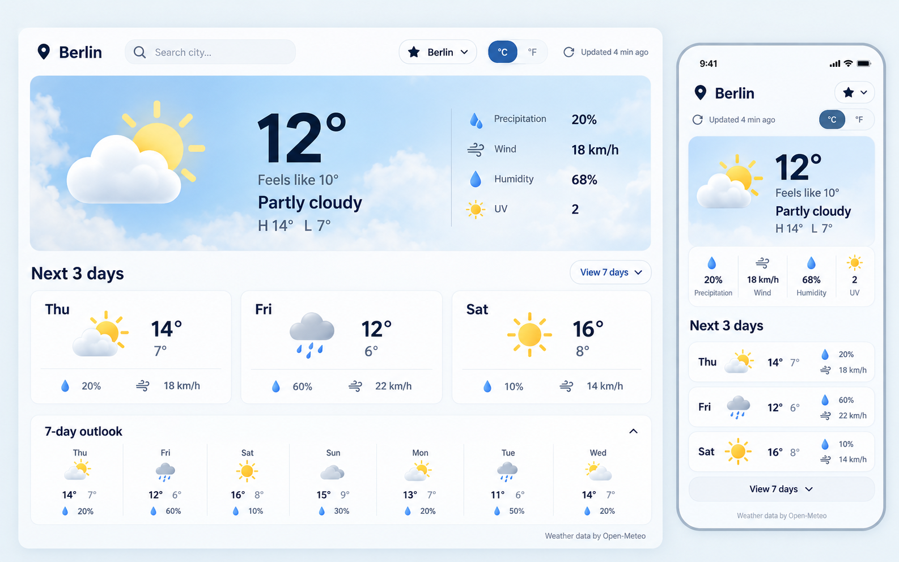

# Weather

Адаптивная погодная панель для одного основного города: текущие условия, прогноз на три дня и раскрываемый прогноз на неделю.



## Возможности

- поиск города с сохранением основного города в браузере;
- выпадающий список из пяти последних выбранных городов;
- текущая температура, ощущаемая температура и срезы на утро, полдень, вечер и ночь;
- влажность, ветер, УФ-индекс и вероятность осадков;
- прогноз на три дня и раскрываемая семидневная сводка;
- температуры на утро, полдень и ночь в карточках трёхдневного прогноза;
- переключение между метрической и имперской системами;
- светлая и тёмная темы с сохранением выбора;
- адаптивный интерфейс для телефона и рабочего стола;
- установка как PWA на телефон или рабочий стол;
- мгновенный показ последнего сохранённого прогноза и offline-запуск после первого посещения;
- встроенный skeleton до загрузки JavaScript и данных;
- лёгкий parallax-эффект основной погодной панели с поддержкой reduced motion;
- серверный прокси к Open-Meteo: SOCKS-адрес не попадает в браузер;
- кэширование запросов и ограничение частоты обращений.

## Локальный запуск

Требуется Node.js 22 или 24.

```bash
npm install
cp .env.example .env.production
npm run build
set -a; source .env.production; set +a
npm start
```

Приложение будет доступно на `http://127.0.0.1:4175`. Для разработки интерфейса запустите `npm run dev`, а API отдельно — `npm run dev:api`.

## Проверки

```bash
npm run check
```

Команда запускает модульные тесты, TypeScript и production-сборку Vite.

Production-сборка также создаёт web app manifest и service worker. Service worker кэширует оболочку приложения, а запрос погоды при медленной сети через две секунды использует последний сетевой ответ; интерфейс параллельно показывает прогноз из локального кэша без ожидания сети.

## Конфигурация

| Переменная | Назначение |
| --- | --- |
| `PORT` | локальный порт, по умолчанию `4175` |
| `WEATHER_SOCKS_PROXY` | SOCKS5/SOCKS5H-прокси для запросов Open-Meteo |
| `APP_VERSION` | ревизия, показываемая в `/healthz` |

Файл `.env.production` не коммитится и на production должен иметь права `600`.

## Данные и лицензии

Погодные данные предоставляет [Open-Meteo](https://open-meteo.com/). Бесплатный hosted API предназначен для некоммерческого использования и требует атрибуции. Иконки — [Meteocons](https://github.com/basmilius/meteocons), MIT.

## Production

Deployment рассчитан на `/var/apps/weather`, PM2-процесс `weather`, loopback `127.0.0.1:4175` и Nginx-домен `weather.kunini.ru`.

```bash
./ops/deploy.sh
./ops/setup-nginx.sh
```

Первый скрипт требует чистый checkout и валидный `.env.production`; второй устанавливает Nginx-конфигурацию и сертификат Let's Encrypt через серверный helper.
